# Parte I. Conceptos fundamentales

>¿Qué es un sistema operativo y cuáles son sus principales funciones?

Es el software fundamental de un dispositivo que gestiona los recursos del hardware, entre sus funciones principales se encontraría la gestión del hardware como la coordinación del procesador, la memoria, y los dispositivos que se encuentran conectados. También se encarga de la administración de la memoria, asignando y liberando espacios en la RAM para los programas en ejecución. Además del control de archivos; organizando, guardando y protegiendo los datos en los discos y unidades de almacenamiento.

>¿Qué es un proceso?

Un proceso es una instancia de un programa informático que se encuentra en ejecución, este incluye el código que se está ejecutando y los recursos que el sistema operativo le asigna, como la memoria, los archivos abiertos que utiliza o los permisos de acceso.

>Explique la diferencia entre un programa y un proceso.

Un programa es el conjunto de instrucciones escritas para poder realizar una tarea, almacenadas en la memoria. Mientras que un proceso es la ejecución activa de un programa, que utiliza recursos del sistema como la CPU y la memoria.

>Explique los estados principales de un proceso:

**Nuevo**
El proceso ha sido recientemente creado, no ha empezado a correr todavía pero su bloque de control de procesos ya está preparado.

**Listo**
El proceso está cargado en memoria y preparado para correrse tan pronto como la CPU esté disponible.

**Ejecutando**
La CPU se encuentra ejecutando el proceso. Con un sistema de un único CPU, solo uno proceso se puede ejecutar a la vez.

**Bloqueado**
El proceso no puede continuar su ejecución porque está esperando por un evento como datos de entrada o salida.

**Terminado**
El proceso ha completado su ejecución o ha sido detenido, y el sistema operativo lo elimina de su memoria.

>¿Qué es el espacio de direcciones de un proceso?

Es el conjunto de direcciones de memoria que el sistema operativo asigna a un programa que pueda ejecutarse de forma independiente y privada.

>¿Cuál es la diferencia entre modo usuario y modo kernel?

El modo de usuario ejecuta aplicaciones regulares con un acceso limitado a los recursos del sistema, mientras que el modo kernel ejecuta el sistema operativo principal con un control total sobre el hardware.

>¿Qué es una llamada al sistema y para qué sirve?

Son rutinas que permiten a una aplicación de usuario solicitar acciones que requieren privilegios especiales, lo que permite ampliar las funciones proporcionadas por el kernel.

>Explique qué función cumple el sistema operativo en la administración de:

**CPU**
Gestiona procesos, permitiendo la programación, sincronización, manejo de puntos muertos y comunicación entre los distintos procesos.
**Memoria**
Controla cómo se almacenan y organizan los datos en la memoria principal y en el almacenamiento secundario que garantiza que los programas obtengan la memoria que necesitan y liberándola cuando ya no se ocupa.
**Archivos**
Organiza y controla cómo se almacenan, nombran y acceden los datos en los dispositivos de almacenamiento, lo que facilita a los usuario encontrar y utilizar los archivos.
**Dispositivos de entrada/salida**
Controla cómo la computadora se comunica con los dispositivos de hardware mediante controladores y técnicas para garantizar un funcionamiento fluido y eficiente.

>¿Qué es la concurrencia?

La concurrencia es la habilidad del sistema operativo para ejecutar múltiples procesos o hilos de manera simultanea, mejorando la utilización de recursos y la eficiencia del sistema ya sea corriéndolos en procesadores separados o a través de cambios de contexto en el mismo procesador.

>Explique qué es una condición de carrera y por qué puede representar un problema para un sistema operativo.

Es un error o un comportamiento inesperado que ocurre cuando dos o más procesos o hilos intentan modificar la misma información al mismo tiempo, y el resultado final depende del orden en que se ejecutaron, esto puede ser un problema ya que sin una coordinación apropiada podría llevar a resultados incorrectos o impredecibles.
# Parte II. Planificación de procesos

## Ejercicio 1. FCFS

| Proceso | Llegada | Ejecución | Inicio | Finalización | Espera | Retorno |
| ------- | ------- | --------- | ------ | ------------ | ------ | ------- |
| P1      | 0       | 8         | 0      | 8            | 0      | 8       |
| P2      | 1       | 4         | 8      | 12           | 7      | 11      |
| P3      | 2       | 2         | 12     | 14           | 10     | 12      |
| P4      | 3       | 5         | 14     | 19           | 11     | 16      |
**Espera promedio:** $7.00 \text{ s}$
**Retorno promedio:** $11.75 \text{ s}$

```mermaid
--- 
config:
  themeCSS: '
    rect#p1 { fill: #658a6c; }
    rect#p2 { fill: #CC0000; }
    rect#p3 { fill: #0000CC; }
    rect#p4 { fill: #00CC00; }
    .milestoneText { fill: #00000 !important; font-weight: bold; }
    .milestone { fill: #FFD700 !important; stroke: #FF1493 !important; }
  '
displayMode: compact
---

gantt
    dateFormat X
    axisFormat %S
    
	section P1
		Llegada P1 : milestone, m1, 0, 0s
	    P1 : p1, 0, 8s
	section P2
		Llegada P2 : milestone, m2, 0, 2s
	    P2 : p2, after p1, 4s
	section P3
		Llegada P3 : milestone, m3, 0, 4s
	    P3 : p3, after p2, 2s
	section P4
		Llegada P4 : milestone, m4, 0, 6s
	    P4 : p4, after p3, 5s
```

---

## Ejercicio 2. SJF

| Proceso | Llegada | Ejecución | Inicio | Finalización | Espera | Retorno |
| ------- | ------- | --------- | ------ | ------------ | ------ | ------- |
| P1      | 0       | 8         | 0      | 8            | 0      | 8       |
| P2      | 1       | 4         | 10     | 14           | 9      | 13      |
| P3      | 2       | 2         | 8      | 10           | 6      | 8       |
| P4      | 3       | 5         | 14     | 19           | 11     | 16      |
**Espera promedio:** $6.50 \text{ s}$
**Retorno promedio:** $11.25 \text{ s}$

```mermaid
--- 
config:
  themeCSS: '
    rect#p1 { fill: #658a6c; }
    rect#p2 { fill: #CC0000; }
    rect#p3 { fill: #0000CC; }
    rect#p4 { fill: #00CC00; }
    .milestoneText { fill: #00000 !important; font-weight: bold; }
    .milestone { fill: #FFD700 !important; stroke: #FF1493 !important; }
  '
displayMode: compact
---
gantt
    dateFormat X
    axisFormat %S
    
	section P1
		Llegada P1 : milestone, m1, 0, 0s
	    P1 : p1, 0, 8s
	section P2
		Llegada P2 : milestone, m2, 0, 2s
	    P2 : p2, after p3, 4s
	section P3
		Llegada P3 : milestone, m3, 0, 4s
	    P3 : p3, after p1, 2s
	section P4
		Llegada P4 : milestone, m4, 0, 6s
	    P4 : p4, after p2, 5s
```


> ¿Por qué el orden de ejecución obtenido mediante SJF es diferente al obtenido mediante FCFS?

Ya que SJF selecciona el siguiente proceso basándose en el que tenga un menor tiempo de ejecución, por lo que no necesariamente será el proceso que entró después, sino que verifica los procesos que se tienen y se toma el de menor duración. A diferencia de FCFS, que solamente se guía por el orden que llegaron.
## Ejercicio 3. SRTF

| Proceso | Llegada | Ejecución | Inicio | Finalización | Espera | Retorno |
| ------- | ------- | --------- | ------ | ------------ | ------ | ------- |
| P1      | 0       | 8         | 0      | 19           | 11     | 19      |
| P2      | 1       | 4         | 1      | 7            | 2      | 6       |
| P3      | 2       | 2         | 2      | 4            | 0      | 2       |
| P4      | 3       | 5         | 7      | 12           | 4      | 9       |
**Espera promedio:** $4.25 \text{ s}$
**Retorno promedio:** $9.00 \text{ s}$

```mermaid
--- 
config:
  themeCSS: '
    rect#p1, rect#p11 { fill: #658a6c; }
    rect#p2, rect#p21 { fill: #CC0000; }
    rect#p3 { fill: #0000CC; }
    rect#p4 { fill: #00CC00; }
    .milestoneText { fill: #00000 !important; font-weight: bold; }
    .milestone { fill: #FFD700 !important; stroke: #FF1493 !important; }
  '
displayMode: compact
---
gantt
    dateFormat X
    axisFormat %S
    
	section P1
		Llegada P1 : milestone, m1, 0, 0s
	    P1 : p1, 0, 1s
		P1 : p11, after p4, 7s
	section P2
		Llegada P2 : milestone, m2, 0, 2s
	    P2 : p2, after p1, 1s
	    P2 : p21, after p3, 3s
	section P3
		Llegada P3 : milestone, m3, 0, 4s
	    P3 : p3, after p2, 2s
	section P4
		Llegada P4 : milestone, m4, 0, 6s
	    P4 : p4, after p21, 5s
```


Explique:

> ¿Qué diferencia existe entre SJF y SRTF respecto a la posibilidad de interrumpir un proceso?

SJF decide cual es el siguiente proceso en ejecutarse dependiendo de los procesos que ya están en la cola de ejecución, si uno nuevo entra mientras se está ejecutando un proceso, se hará la comparación hasta que haya terminado el proceso actual, a diferencia de SRTF ya que independientemente de si hay un proceso ejecutándose en el momento, comparará el tiempo restante de ejecución entre el que se está ejecutando y el entrante, y si el proceso entrante es de menor tiempo restante, entonces interrumpirá el proceso actual para empezar el entrante.
## Ejercicio 4. Round Robin

| Proceso | Llegada | Ejecución | Inicio | Finalización | Espera | Retorno |
| ------- | ------- | --------- | ------ | ------------ | ------ | ------- |
| P1      | 0       | 8         | 0      | 19           | 11     | 19      |
| P2      | 1       | 4         | 3      | 15           | 10     | 14      |
| P3      | 2       | 2         | 6      | 8            | 4      | 6       |
| P4      | 3       | 5         | 8      | 17           | 9      | 14      |
**Espera promedio:** $8.50 \text{ s}$
**Retorno promedio:** $13.25 \text{ s}$

```mermaid
--- 
config:
  themeCSS: '
    rect#p1, rect#p11, rect#p12 { fill: #658a6c; }
    rect#p2, rect#p21 { fill: #CC0000; }
    rect#p3 { fill: #0000CC; }
    rect#p4, rect#p41 { fill: #00CC00; }
    .milestoneText { fill: #00000 !important; font-weight: bold; }
    .milestone { fill: #FFD700 !important; stroke: #FF1493 !important; }
  '
displayMode: compact
---

gantt
    dateFormat X
    axisFormat %S
    
	section P1
		Llegada P1 : milestone, m1, 0, 0s
	    P1 : p1, 0, 3s
	    P1 : p11, after p4, 3s
	    P1 : p12, after p41, 2s
	section P2
		Llegada P2 : milestone, m2, 0, 2s
	    P2 : p2, after p1, 3s
	    P2 : p21, after p11, 1s
	section P3
		Llegada P3 : milestone, m3, 0, 4s
	    P3 : p3, after p2, 2s
	section P4
		Llegada P4 : milestone, m4, 0, 6s
	    P4 : p4, after p3, 3s
	    P4 : p41, after p21, 2s
```



> ¿Cómo afecta el tamaño del quantum al comportamiento de Round Robin?

Si el tamaño del quantum es muy pequeño el sistema de procesamiento se acerca a un reparto ideal, pero llega a pagar un costo alto al cambiar constantemente de contexto, que en el extremo podría llegar a tomar más tiempo que los mismos procesos. Sin embargo, si es muy grande, RR puede llegar a degradarse a FCFS, ya que cada proceso termina su ejecución completa antes de terminar su turno, perdiendo la ventaja de una buena respuesta. Por esto mismo es que se busca un valor promedio, normalmente un poco mayor que una interacción de usuario pero menor a la ráfaga promedio de procesos.

# Parte III. Análisis de coordinación de procesos

>¿Cuál debería ser el valor final del contador?

El valor final debería ser 2, ya que el primer proceso incrementa el contador una vez y el segundo proceso lo incrementa de igual manera una vez.

>¿Cuál fue el valor obtenido en la secuencia anterior?

El valor que se obtuvo fue de 1.

>¿Por qué se produjo esta diferencia?

Porque ambos procesos accedieron al contador concurrentemente sin ninguna forma de sincronización, por lo que ambos procesos leyeron el mismo valor inicial de 0 antes que alguno guardara el incremento. Como ambos calcularon 1, uno de los incrementos se perdió al momento en que ambos guardaron el mismo resultado.

>¿Cuál es la sección crítica?

Es la instrucción `contador = contador + 1`, es decir las tres operaciones que se realizaron sobre el contador. Es la sección donde un proceso accede y modifica el recurso compartido, por lo que debe de ejecutarse de manera más controlada.

>¿Dónde se encuentra la condición de carrera?

La condición de carrera se encuentra en el acceso a la variable contador, específicamente cuando los dos procesos ejecutan las operaciones de lectura, incremento y escritura sin coordinarse.

>¿Qué mecanismo debería utilizarse para evitar este problema?

Se debería utilizar un mecanismo de exclusión mutua para proteger la sección crítica. Antes de modificar el contador, el proceso debería de adquirir el mutex para que mientras el proceso se encuentra ejecutando la sección crítica el otro tenga que esperar a que el anterior proceso termine. Cuando termina de ejecutar la instrucción, libera el mutex y permite que el otro proceso continúe; de modo que solamente un proceso pueda modificar el contador a la vez.
# Parte IV. Implementación práctica

```cpp
#include <iostream>
#include <thread>

int contador = 0;

void procesoA() {
    for (int i = 0; i < 100000; i++) {
        contador++;
    }
}

void procesoB() {
    for (int i = 0; i < 100000; i++) {
        contador++;
    }
}

int main() {
    std::thread p1(procesoA);
    std::thread p2(procesoB);
    
    p1.join();
    p2.join();
    
    std::cout << "Contador final: " << contador << std::endl;
    
    return 0;
}
```

![[Pasted image 20261014190701.png|center]]

| Ejecución | Valor Esperado | Valor obtenido |
| --------- | -------------- | -------------- |
| 1         | 200000         | 108735         |
| 2         | 200000         | 158107         |
| 3         | 200000         | 149060         |
| 4         | 200000         | 102640         |
| 5         | 200000         | 121223         |
>¿El resultado siempre coincide con el?

No, en ninguna de las ejecuciones del programa se logró llegar al resultado esperado de 200000.

>¿Por qué puede variar el resultado?

Debido a que la modificación del contador no es un problema indivisible, por lo que los hilos que llevan al cabo el procedimiento de alterar el contador intentan acceder al registro del contador al mismo tiempo, por lo que sus pasos pueden intercalarse.

>¿Qué relación tiene con la condición de carrera?

Este problema ocurre precisamente por la condición de carrera, distintos hilos intentan acceder a un mismo recurso compartido y al menos uno lo modifica, por lo que el resultado de la iteración depende del orden en el que se ejecutaron los procesos.

>¿Por qué ejecutar varias veces produce resultados diferentes?

Debido a que el planificador del sistema operativo decide cuando se va a ejecutar cada hilo, cuando se interrumpe y en cuál núcleo está ejecutándose. Depende de la carga del sistema, otros procesos, interrupciones, y el momento en que se ejecutaron; todo esto cambia cada vez que se ejecuta el programa.
# Parte V

```cpp
#include <iostream>
#include <thread>
#include <mutex>

int contador = 0;
std::mutex mutexContador;

void procesoA() {
    for (int i = 0; i < 100000; i++) {
        mutexContador.lock();      
        contador++;                
        mutexContador.unlock();    
    }
}

void procesoB() {
    for (int i = 0; i < 100000; i++) {
        mutexContador.lock();
        contador++;
        mutexContador.unlock();
    }
}

int main() {
    std::thread p1(procesoA);
    std::thread p2(procesoB);
    
    p1.join();
    p2.join();
    
    std::cout << "Contador final: " << contador << std::endl;
    
    return 0;
}
```

![[Pasted image 20261014191228.png|center]]

| Ejecución | Valor Esperado | Valor obtenido |
| --------- | -------------- | -------------- |
| 1         | 200000         | 200000         |
| 2         | 200000         | 200000         |
| 3         | 200000         | 200000         |
| 4         | 200000         | 200000         |
| 5         | 200000         | 200000         |
>Comparación con los resultados del programa original

En el programa original se tuvieron distintos resultados cada vez que fue ejecutado y no se tuvo nunca el valor esperado.
En cambio, cuando utilizamos `mutex` el resultado fue de 200000 en todas las veces que se ejecutó, demostrando que el mutex nos permite controlar el acceso al recurso compartido y evita que se pierdan incrementos.

>Identifique exactamente que instrucciones forman parte de la sección crítica

La sección crítica es únicamente la línea `contador++`. Aunque sea una sola instrucción, esta en su interior consta de 3 operaciones:
- Lectura del valor
- Incremento del valor
- Reescritura del valor

>Explique como el mutex evita que los dos procesos modifiquen simultáneamente el contador

El mutex permite que solo uno de los procesos entren a la sección crítica a la vez. Por lo que cuando un proceso es bloqueado, el otro proceso debe esperar hasta que el anterior termine y lo libere. Lo que permite que los incrementos se realicen de manera controlada y de esa forma evita que ambos intenten modificar el contador al mismo tiempo, previniendo la condición de carrera.